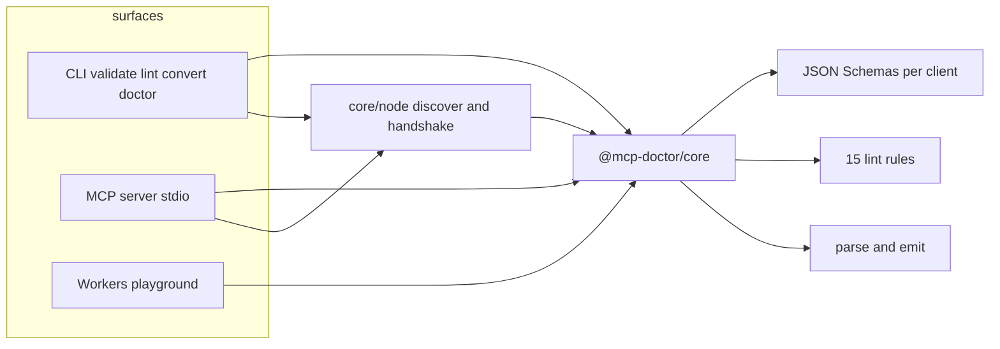
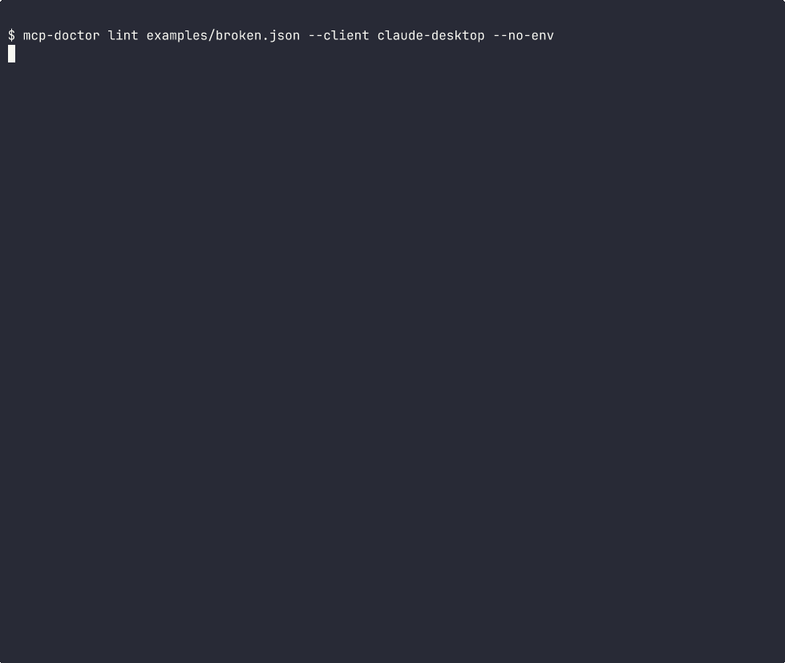

# mcp-doctor

[](https://github.com/kfairley9999/mcp-doctor/actions/workflows/ci.yml)

**Live playground:** https://mcp-doctor.kfairley9999.workers.dev

MCP configs fail quietly. A missing `-y`, a `url` where the client reads `serverUrl`, or an `npx` that a GUI cannot see on `PATH` looks like a client bug and is usually the config. mcp-doctor checks the file against the client that will load it, rewrites it for the client you actually use, and opens a real initialize handshake so you can see the failure.

Three surfaces, one library:

- `mcp-doctor` CLI: `validate`, `lint`, `convert`, `doctor`
- an MCP server, so an agent can inspect the setup it is running inside
- a Cloudflare Workers playground that checks a paste in the request and then drops it

## The problem

There is still no standard MCP config schema. [modelcontextprotocol/modelcontextprotocol#292](https://github.com/modelcontextprotocol/modelcontextprotocol/issues/292) (51 thumbs-up) asks for one. Until it exists, every client invented a dialect:

- Claude Desktop: `claude_desktop_config.json`
- Claude Code: `.mcp.json`
- Cursor: `.cursor/mcp.json`
- VS Code: `.vscode/mcp.json`
- Windsurf: `mcp_config.json`
- Cline: `cline_mcp_settings.json`
- Codex: `~/.codex/config.toml`
- Gemini CLI: `~/.gemini/settings.json`
- Zed: `context_servers` inside `settings.json`

The practical failures are well known. [modelcontextprotocol/servers#64](https://github.com/modelcontextprotocol/servers/issues/64) (147 thumbs-up) is `npx` disappearing under nvm because GUI apps do not load the shell. [cline/cline#902](https://github.com/cline/cline/issues/902) is `npx` on Windows, which is a `.cmd` shim `CreateProcess` will not run. [anthropics/claude-code#5826](https://github.com/anthropics/claude-code/issues/5826) is Claude Code refusing a custom server that was pasted from another client's example.

SchemaStore does not ship a schema for these filenames. Converters such as mcp-config-converter, mcp-config-sync, and mcp-installer copy or install a block. None of them validate it, lint it, or speak MCP to the server.

## Client support

"Yes" means the field survives a conversion into that client. A blank cell is reported as a drop, with the reason, instead of being invented.

| Field              | Claude Desktop | Claude Code    | Cursor       | VS Code                     | Windsurf                 | Cline          | Codex          | Gemini CLI        | Zed               |
| ------------------ | -------------- | -------------- | ------------ | --------------------------- | ------------------------ | -------------- | -------------- | ----------------- | ----------------- |
| Root key           | `mcpServers`   | `mcpServers`   | `mcpServers` | `servers`                   | `mcpServers`             | `mcpServers`   | `mcp_servers`  | `mcpServers`      | `context_servers` |
| Format             | JSON           | JSON           | JSONC        | JSONC                       | JSON                     | JSON           | TOML           | JSON              | JSONC             |
| command, args, env | yes            | yes            | yes          | yes                         | yes                      | yes            | yes            | yes               | yes               |
| cwd                |                |                |              | yes                         |                          |                | yes            | yes               |                   |
| envFile            |                |                | yes          | yes                         |                          |                |                |                   |                   |
| Remote URL         |                | `url` + `type` | `url`        | `url` + `type`              | `serverUrl`              | `url` + `type` | `url`          | `httpUrl` / `url` | `url`             |
| headers            |                | yes            | yes          | yes                         | yes                      | yes            | `http_headers` | yes               | yes               |
| Timeout            |                | ms             |              |                             |                          | ms             | seconds        | ms                |                   |
| Disabled           |                |                |              |                             |                          | `disabled`     | `enabled`      |                   |                   |
| autoApprove        |                |                |              |                             |                          | yes            |                |                   |                   |
| trust              |                |                |              |                             |                          |                |                | yes               |                   |
| SSE kept distinct  |                | yes            |              | yes                         |                          | yes            |                | yes (`url`)       |                   |
| WebSocket          |                | yes            |              |                             |                          |                |                |                   |                   |
| Interpolation      | none           | `${VAR}`       | `${env:VAR}` | `${env:VAR}`, `${input:id}` | `${env:VAR}`, `${file:}` | none           | none           | `$VAR`, `${VAR}`  | none documented   |

Sources for the golden fixtures: [Claude Desktop](https://modelcontextprotocol.io/docs/develop/connect-local-servers), [Claude Code](https://code.claude.com/docs/en/mcp), [Cursor](https://cursor.com/docs/mcp), [VS Code](https://code.visualstudio.com/docs/agents/reference/mcp-configuration), [Windsurf](https://docs.devin.ai/windsurf/plugins/cascade/mcp), [Cline](https://github.com/cline/cline/blob/main/docs/mcp/mcp-overview.mdx), [Codex](https://developers.openai.com/codex/config-reference), [Gemini CLI](https://geminicli.com/docs/tools/mcp-server/), [Zed](https://zed.dev/docs/ai/mcp).

Cursor, Windsurf, and Zed store HTTP and SSE as the same URL. Conversion keeps the URL and says the transport label will not survive. Codex's `url` is streamable HTTP. Claude Desktop's JSON file only launches stdio. A remote server is omitted and reported. This tool does not wrap it in `mcp-remote` for you.

## Lint rules

Each rule has a fix sentence. `mcp-doctor lint --fix` applies only the two edits that cannot change which program you meant: prepend `-y`, and split a command string into `command` plus `args`.

| Rule                       | What it catches                                                               | Fix                                                                                                                                        |
| -------------------------- | ----------------------------------------------------------------------------- | ------------------------------------------------------------------------------------------------------------------------------------------ |
| `npx-missing-yes`          | `npx` or `npm exec` with no `-y` / `--yes`                                    | Put `-y` first. A prompt never gets a keypress.                                                                                            |
| `windows-cmd-wrapper`      | `npx`, `npm`, `pnpm`, `yarn` launched directly                                | `command: "cmd"`, `args: ["/c", "npx", ...]`. Error on Windows, warning elsewhere. [cline#902](https://github.com/cline/cline/issues/902). |
| `command-not-on-path`      | stdio command missing from `PATH`                                             | Absolute path, or install it. Needs a local probe.                                                                                         |
| `version-manager-shadow`   | `node`/`npx` resolves outside nvm, Volta, fnm, or asdf                        | Point `command` at that manager's shim. [servers#64](https://github.com/modelcontextprotocol/servers/issues/64).                           |
| `missing-env-reference`    | `${VAR}` / `${env:VAR}` / `$VAR` unset, or an empty secret                    | Export it where the client can see it. GUI apps skip the shell rc.                                                                         |
| `env-interpolation-syntax` | `${VAR}` where the client wants `${env:VAR}`, or the reverse                  | Rewrite to the form that client expands.                                                                                                   |
| `plaintext-secret`         | Tokens, keys, URL passwords, placeholders                                     | Use the client's interpolation. The message does not echo the value.                                                                       |
| `url-field-name`           | `url` vs `serverUrl` vs `httpUrl`                                             | Rename to the field that client reads.                                                                                                     |
| `transport-mismatch`       | `type` disagrees with `command`/`url`, or Claude Code has a URL and no `type` | Set the type the client documents. Cline with no type means SSE.                                                                           |
| `stdio-missing-command`    | stdio entry with no command                                                   | Set `command`.                                                                                                                             |
| `remote-missing-url`       | http/sse/ws entry with no URL                                                 | Set the URL field.                                                                                                                         |
| `command-contains-args`    | `command` is `"npx -y pkg"`                                                   | Split it. Clients do not run a shell.                                                                                                      |
| `relative-path`            | `./`, `../`, or `~`                                                           | Absolute path. `~` is not expanded.                                                                                                        |
| `insecure-http`            | `http://` to a non-loopback host                                              | Use https. Credentials on cleartext are an error.                                                                                          |
| `suspicious-timeout`       | `30` where the unit is milliseconds, or `30000` where Codex wants seconds     | Match the unit.                                                                                                                            |

`lint` prints text, `--format json`, or `--format sarif`. Warnings exit 0 unless `--strict`. Errors exit 1.

## Install

```bash
npm ci
npm run build
```

The CLI is `node packages/cli/dist/main.js`, also `npm run mcp-doctor -- <args>` from the repo root. This package is not published to npm, and the npm name `mcp-doctor` belongs to an unrelated package, so `npm install mcp-doctor` does not install this tool.

```bash
npm run mcp-doctor -- validate .cursor/mcp.json --client cursor
npm run mcp-doctor -- lint .mcp.json --format sarif
npm run mcp-doctor -- convert claude_desktop_config.json --from claude-desktop --to windsurf
npm run mcp-doctor -- doctor --timeout 10000
```

`doctor` discovers the config files listed above, lints them, and performs an MCP `initialize` handshake (stdio, streamable HTTP, and a best-effort SSE connect) with a timeout. It only reads config files. It does start the servers those files name. Pass `--home` and `--root` to look somewhere other than your real home, and `--no-handshake` to skip the spawn.

A file of `-` reads stdin. `convert` writes the config to stdout and the carry report to stderr, so the config can be piped.

## MCP server

The server speaks stdio through `@modelcontextprotocol/sdk` and exposes `validate_config`, `lint_config`, `convert_config`, `diagnose_server`, and `list_client_configs`. `diagnose_server` is the handshake. `list_client_configs` does not start servers.

Build first (`npm run build`), then point the client at `packages/mcp-server/dist/main.js`. Use the absolute path on your machine.

Claude Desktop, `claude_desktop_config.json`:

```json
{
  "mcpServers": {
    "mcp-doctor": {
      "command": "node",
      "args": ["/absolute/path/to/mcp-doctor/packages/mcp-server/dist/main.js"]
    }
  }
}
```

Cursor, `.cursor/mcp.json` or `~/.cursor/mcp.json`:

```json
{
  "mcpServers": {
    "mcp-doctor": {
      "command": "node",
      "args": ["/absolute/path/to/mcp-doctor/packages/mcp-server/dist/main.js"]
    }
  }
}
```

Claude Code, `.mcp.json`:

```json
{
  "mcpServers": {
    "mcp-doctor": {
      "type": "stdio",
      "command": "node",
      "args": ["/absolute/path/to/mcp-doctor/packages/mcp-server/dist/main.js"]
    }
  }
}
```

## Architecture



The playground imports only the pure library. Handshake and `PATH` checks need a process, and running them on Cloudflare would execute whatever command was pasted. They stay on the machine.

## Playground

Paste a config, see validation, lint, and the same servers emitted for every client. The page posts the text (up to 64KB) to `/api/analyze` on this Worker. The Worker answers and discards the body. It does not log the body, store it, or send it anywhere else.

Live demo: **https://mcp-doctor.kfairley9999.workers.dev** (Cloudflare Workers free tier).



### Deploy

The live demo runs on the Cloudflare Workers free tier. CI runs the dry run and does not deploy. Nothing in the Worker uses a paid binding. No secrets, no KV, no D1.

```bash
cd playground
npx wrangler login
npx wrangler deploy
```

`npm run playground:dry-run` from the repo root bundles the Worker and stops before upload. Local preview:

```bash
npx tsc -b packages/core
npm run dev -w mcp-doctor-playground
```

That listens on port 47471.

## Development

```bash
npm ci
npm test
npm run test:coverage
npm run lint
npm run schemas:validate
```

CI on Node 20 and 22 runs lint, typecheck, tests with the 85% coverage gate, and schema self-validation. The playground bundle and `wrangler deploy --dry-run` run on Node 22 only, because Wrangler 4 requires Node 22.12 or newer.

## Limitations

- The schemas follow public docs as of November 2026. Clients change fields without a spec. A passing schema means the shape is one they document, not that this week's build still accepts it.
- Same-client emit is stable in the canonical model, not byte-for-byte. Codex comments and key order are not preserved. Zed's legacy `{ command: { path } }` object is read and written back in the flat form.
- `~/.claude.json` holds project-scoped servers under `projects`. `doctor` reads those. `convert` rewrites the top-level `mcpServers` map.
- `doctor` and `diagnose_server` run the configured command. They are not a sandbox. Review the file first.
- A green `PATH` check in the terminal can still fail inside Claude Desktop or Cursor, because those processes do not source your shell. The version-manager rule exists for that case and can still miss a manager it cannot see without launching a shell.
- WebSocket handshake is not implemented. SSE is a short read for the `endpoint` event, then one POST.
- Nested interpolation such as `${A:-${B}}` is not modeled. Claude Code's credential names that expand to empty are not special-cased.
- The playground cannot check `PATH`, nvm, or a live server. Doing so would run untrusted commands and contact arbitrary URLs.
- Not published to npm. Not submitted to SchemaStore.

## Roadmap

- Submit the schemas to SchemaStore once a client freezes a shape.
- Fixes for the mechanical renames (`url` to `serverUrl`, `${env:VAR}` to `${VAR}`) behind an explicit flag.
- A file watcher for `lint`.
- Continue, Roo, and other clients that copy one of these dialects.
- A fuller SSE and WebSocket handshake.

## How it was built

Designed and directed by Kevin Fairley, built with AI coding agents.

MIT license. See [CONTRIBUTING.md](CONTRIBUTING.md).
